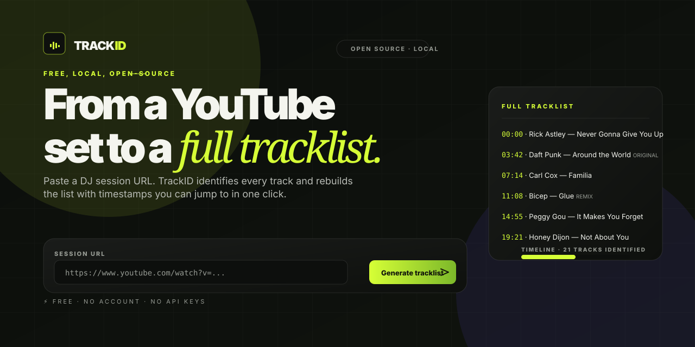

# TrackID

> Free, open-source, self-hosted tool that turns any DJ set on YouTube into a
> complete tracklist with timestamps. No login, no API keys, no subscriptions.

[](#testing)
[](https://docs.astral.sh/ruff/)
[](https://mypy.readthedocs.io/)
[](LICENSE)
[](#requirements)



## Why

YouTube is full of incredible DJ sets. TrackID reads the chapters first; if
they're missing, it downloads the audio once, detects the real transitions with
FFmpeg, fingerprints each segment with Shazam, and ships you the result.

Everything happens on your machine. The YouTube metadata and the audio file are
cached on disk. The Shazam fingerprints are cached by content hash, so a rescan
of the same set — even partially — never re-uploads or re-recognises a sample
that hasn't changed.

## Highlights

- **Two analysis modes.** Quick for casual sets, Thorough with silence-based
  transition detection and a finer sampling grid.
- **Smart cache.** Audio and Shazam fingerprints are hashed and persisted in
  SQLite, so re-analyses reuse previous work.
- **Rescan on demand.** Click any row to re-identify ±2 minutes around the
  timestamp with the heavier sampling grid.
- **Cancellation.** Stop an in-flight job mid-recognition; partial results are
  discarded cleanly.
- **Live progress.** Server-Sent Events push status messages, ETA, and detected
  transitions to the browser. No polling.
- **Shareable jobs.** Every analysis is persisted; reopening
  `?id=<job-id>` resumes the same record.
- **Exports.** Plain text, CSV, JSON, or an M3U playlist that drops directly
  into VLC, mpv, Mixxx or any media player.

## How it works

```
┌────────┐   chapters / description     ┌──────────────┐
│YouTube │ ──────────────────────────▶ │ Tracklist?   │
└────────┘                              └──────┬───────┘
                                              │ no
   ┌──────────────────────────────────────────┘
   ▼
┌────────┐ best audio    ┌──────┐ samples     ┌──────────────┐
│ yt-dlp │ ─────────────▶│ cache│ ──────────▶ │ FFmpeg       │
└────────┘               └──────┘              │ silencedetect│
                                              └──────┬───────┘
                                                     │ transitions
                                              ┌──────▼───────┐
                                              │ Shazam       │
                                              │ fingerprint  │
                                              │ + cache      │
                                              └──────┬───────┘
                                                     │ results
                                              ┌──────▼───────┐
                                              │ Tracklist    │
                                              │ + metadata   │
                                              └──────────────┘
```

1. **Inspect.** `yt-dlp` reads title, duration, thumbnail, chapters, and the
   first five description lines. If a usable tracklist is already there, we
   use it as-is — no audio download needed.
2. **Download.** Otherwise, the best audio stream (≤192 kbps) is fetched and
   stored under `data/audio/<video-id>.m4a`.
3. **Detect transitions.** FFmpeg's `silencedetect` filters runs of silence
   longer than 0.4 s at -32 dBFS. They become extra sampling positions layered
   on top of the regular grid (Thorough mode only).
4. **Sample.** Each position is cut as a 12 s mono MP3 at 44.1 kHz / 96 kbps.
5. **Identify.** The sample's SHA-256 hash is checked against the SQLite
   fingerprint cache. On miss it's sent to Shazam's public endpoint and the
   response (including offset, artwork and link) is cached.
6. **Group.** Consecutive identical fingerprints collapse into one track. The
   Shazam `offset` field is used to estimate the precise start time when
   available; otherwise the midpoint of the two flanking samples is used.
7. **Persist.** The result, audio path, fingerprint cache and event log are all
   in `data/trackid.db`.

## Quick start

### Docker

```bash
git clone https://github.com/javiservices/trackid
cd trackid
docker compose up --build
# open http://localhost:8000
```

### Local

```bash
python3 -m venv .venv
source .venv/bin/activate
pip install -e ".[dev]"
uvicorn app.main:app --reload
```

Then visit `http://localhost:8000`.

> `imageio-ffmpeg` ships with a static FFmpeg binary inside its wheel, so a
> separate system install isn't required for development. The Docker image
> installs `ffmpeg` from apt and overrides `IMAGEIO_FFMPEG_EXE` to point at it.

## Modes

| Mode        | Sample interval | Transition detection | Concurrency | Typical 1-h set |
| ----------- | --------------: | -------------------: | ----------: | --------------: |
| Quick       | 75 s            | —                    | 4           | 1–2 min         |
| Thorough    | 35 s            | ✓                    | 2           | 4–7 min         |

Thorough also uses a finer grid (`max_samples=320` vs `80`) and a higher
segment limit (default 4 h per session). Both modes honour cancellation, the
cache, and the SSE event stream.

## API

All endpoints live under `/api`. JSON in, JSON out unless noted.

| Method | Path                          | Description                                |
| ------ | ----------------------------- | ------------------------------------------ |
| GET    | `/api/health`                 | Status, version, active and cached counts  |
| POST   | `/api/jobs`                   | Create a job `{ url, mode }`               |
| GET    | `/api/jobs`                   | List recent jobs                           |
| GET    | `/api/jobs/{id}`              | Inspect a job                              |
| GET    | `/api/jobs/{id}/events`       | Subscribe to Server-Sent Events            |
| POST   | `/api/jobs/{id}/cancel`       | Cancel an in-flight job                    |
| POST   | `/api/jobs/{id}/rescan`       | Queue a section rescan `{ start, end }`    |
| DELETE | `/api/jobs/{id}`              | Delete the job and its history             |
| GET    | `/api/jobs/{id}/export`       | Export as `json`, `csv`, `txt` or `m3u`    |

The OpenAPI spec lives at `/api/docs`.

### Event format

Each SSE message is `event: <status>` followed by a JSON body:

```json
{
  "status": "recognizing",
  "progress": 42,
  "message": "Recognized 12 of 28 samples"
}
```

A typical lifecycle is `queued → inspecting → downloading → recognizing →
completed`. `failed` and `cancelled` are terminal.

## Configuration

All knobs are environment variables. The defaults in `pyproject.toml` are sane
for personal use.

| Variable                    | Default          | Description                                            |
| --------------------------- | ---------------: | ------------------------------------------------------ |
| `TRACKID_DATA`              | `./data`         | SQLite + audio cache directory                         |
| `TRACKID_MAX_DURATION`      | `14400`          | Hard cap per session, seconds                          |
| `TRACKID_MAX_WORKERS`       | `1`              | Concurrent analysis tasks (set to `0` for tests)       |
| `TRACKID_SAMPLE_INTERVAL`   | `45`             | Base sampling interval, seconds                        |
| `TRACKID_MAX_SAMPLES`       | `240`            | Hard cap on number of samples per session              |
| `TRACKID_CONCURRENCY`       | `2`              | Recognition requests in flight per worker              |
| `LOG_LEVEL`                 | `INFO`           | Standard logging level                                 |

## Development

```bash
# Linting and formatting
ruff check .
ruff format .

# Strict type-check
mypy app

# Tests (uses TRACKID_MAX_WORKERS=0, no real Shazam calls)
pytest
```

The repository ships with the green CI statuses you'd expect:

- **34 pytest tests** covering URL parsing, recognizer logic, fingerprint
  cache, audio cache, job lifecycle, cancellation, rescan and exports.
- **Ruff** with a curated rule set (`E,F,I,UP,B,SIM,ASYNC`) at 100 cols.
- **Mypy `--strict`** over the entire `app/` package.

## Limitations

- **Accuracy is bounded by the audio.** Clean DJ sets with distinct transitions
  produce near-perfect results. Mashups, beat-juggling, unreleased IDs and long
  blends reduce confidence.
- **Shazam is unofficial.** It reverse-engineers the public mobile endpoint.
  Rate limits and protocol changes can affect availability.
- **YouTube throttling.** Some networks block automated downloads. Run TrackID
  from a residential connection or a small VPS for best results.
- **No DRM-protected or region-locked videos.** Use only publicly available
  content for which you have permission to extract metadata.

Please use TrackID for personal listening and tracklist discovery. Respect
artists, labels, and the terms of YouTube and Shazam.

## License

MIT — see [`LICENSE`](LICENSE).

## Acknowledgements

Built and curated by [@javilabarumdj](https://www.instagram.com/javilabarumdj)
— follow along on [Instagram](https://www.instagram.com/javilabarumdj) and
[TikTok](https://www.tiktok.com/@javilabarumdj) for the mixes behind it.

Pipes:

- [`yt-dlp`](https://github.com/yt-dlp/yt-dlp) for YouTube access
- [`ShazamIO`](https://github.com/nesebar/shazamio) for identification
- [`FastAPI`](https://fastapi.tiangolo.com/) and
  [`FFmpeg`](https://ffmpeg.org/) for the rest of the pipeline
